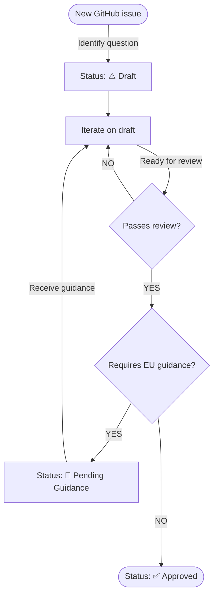

# FAQ Contributing Guidelines

How the FAQ works: its lifecycle, file format, lists, reference syntax and pull requests. How to write a FAQ is in the [style guide](./STYLE.md).

## Goals

1. Include questions in the FAQs as soon as they are identified; do not wait for an answer to solidify before adding them to the repository.
2. Make drafting the answers an iterative process; it is better to have an approximate answer than none, provided the answer is clearly identified as such (see next point).
3. Clearly identify the [maturity level](#maturity-level) of each answer.
4. Improve accuracy, consistency, and quality of answers through a more rigourous [final review process](#review).


## Maturity level

The maturity level of the answers contained in the FAQ are indicated using the following system:

| Maturity level status | Icon | Description |
| :-------------------- |:----:| :---------- |
| Draft                 |  ⚠️  | Hasn't been reviewed by the FAQ TF. Answer may be incomplete or incorrect. |
| Pending Guidance      |  🛑  | Identified by the FAQ TF as requiring input from the EU Commission. |
| Approved              |  ✅  | Has been reviewed by the FAQ TF. Represents community best effort to provide an actionable answer. |

### Questions which would benefit from European Commission guidance

FAQs which would benefit from guidance from the European Commission include a `pending-guidance` field in their YAML frontmatter that references a dedicated guidance request file in the `pending-guidance/` folder.

Example:
```yaml
---
Status: ⚠️ Draft
guidance-id: legal-person-definition
Related issues: https://github.com/...
---
```

## Review

The FAQ TF Review should check for the following:

- [ ] There are no objections about the inclusion of the question
- [ ] There are no objections about the provided answer
- [ ] The question and answer follow the [style guide](./STYLE.md)
- [ ] The answer is accurate
- [ ] The answer is properly sourced and referenced

An approved FAQ is not reworded for style. A review of one proposes the smallest edit that makes it cite its sources and agree with them: a citation added to a sentence that is right, a rewritten sentence only where a source contradicts it. Where the Commission's guidance contradicts the FAQ, say so plainly and propose the correction.

## Lifecycle

FAQs follow the below lifecycle:



## Format

There is one question per file.

The filename should be a short but informative slug.

All FAQ files are stored in subdirectories of the `faq` directory.

## Guidance Requests

The `pending-guidance/` folder contains dedicated files for EU Commission guidance requests that are referenced by multiple FAQs.

### File format

All files are markdown files with YAML frontmatter.

```md
---
Status: [ICON] [MATURITY_LEVEL]
Related issues: [URL], [URL]
---

# [QUESTION]

[DIRECT ANSWER]

[MAIN CONDITION OR CLARIFICATION, WITH ITS CITATION]

[SUPPORTING DETAIL, POINTERS TO RELATED FAQS]

[REFERENCE-STYLE LINK DEFINITIONS]
```

| Field | Use |
|---|---|
| `Status` | The [maturity level](#maturity-level), icon included. |
| `Related issues` | Every issue that asks the question, comma-separated. The site links them from the FAQ and the pull request closes them. When editing a FAQ, keep the issues it lists and add the new one; never drop one. |
| `guidance-id` | Optional. The id of the request in `pending-guidance/` the FAQ depends on. It stays while that request is open. |
| `canonical-id` | Optional. The old id of a FAQ that was moved: see [Moving an FAQ](#moving-an-faq). |

The question is the file's single `#` heading. External links are [reference style links][], defined at the end of the file.

### Moving an FAQ

An FAQ's id, and so its URL on [cra.orcwg.org](https://cra.orcwg.org/), comes from where its file is: `faq/cra-itself/scope.md` is `cra-itself/scope`, at https://cra.orcwg.org/faq/cra-itself/scope/. To move an FAQ to another folder, for example into a sublist's folder, without changing its URL, give its old id as `canonical-id` in the frontmatter. `faq/maintainers/downstream/transparency.md` was moved from `faq/maintainers/` that way, and is still `maintainers/transparency`:

```yaml
---
canonical-id: maintainers/transparency
Status: ✅ Approved
Related issues: https://github.com/orcwg/cra-hub/issues/70
---
```

The FAQ keeps its URL, its API endpoint, and its `[[maintainers/transparency]]` references. Lists and relative links find it where the file now is: the sublist's `README.yml` lists it by its filename (`transparency`), and relative links to and from the file follow its new path, so update them when you move it. Move the file in a pull request that changes little else in it (adding `canonical-id` and fixing relative links is fine), so git sees a rename: the FAQ then keeps its dates on the site, and the move doesn't show it as recently updated. A new FAQ doesn't need a `canonical-id`: one written in a sublist's folder is `<category>/<sublist>/<slug>`, referenced as `[[maintainers/scope/new-faq]]`. Two FAQs can't have the same id: the site's build fails if they do.

### Lists

Each category is a folder with a `README.yml`: its `title`, `description`, `icon`, and `faqs`, the ordered list a reader meets its FAQs in. `faq/README.yml` is the list of categories; a new category needs its own `README.yml` and an entry there.

An example with each kind of entry:

```yaml
title: Steward obligations
description: For foundations and companies that are open-source software stewards and want to know what the CRA asks of them.
icon: 📋
faqs:
  - start-date
  - official/faq_5-5
  - maintainers/contributors
  - reporting
```

An entry of `faqs` is one of:

- a FAQ in the same folder, by its filename without `.md`;
- a FAQ from another category, by its id (`maintainers/contributors`);
- a FAQ of the Commission or ENISA, by its id (`official/faq_6-10`, `srp/faq_18`, `cra-basics/…`);
- a sublist: a subfolder with its own `README.yml`, by the folder's name.

Lists are flat: a sublist is listed from its parent, and its FAQs live in its folder. A FAQ that belongs to two lists is listed from both, not copied. A FAQ file is listed once in its own folder's `README.yml`.

`title` and `description` are unquoted YAML: a colon followed by a space inside one breaks the site's build, and every deploy until it is fixed. Parse every `README.yml` you touch before pushing:

```bash
python3 -c 'import yaml,sys; [yaml.safe_load(open(f)) for f in sys.argv[1:]]' faq/README.yml faq/*/README.yml faq/*/*/README.yml
```

How to order a list, when to split it and how to write its description: [style guide](./STYLE.md#lists).


## References

A double-bracket reference the site can't resolve renders as literal brackets, so check the forms below before pushing. They don't render on GitHub either: in a pull request or an issue comment, write the source out ("Article 3(14) of the CRA").

### Cross-References

To reference another FAQ, put its id in double brackets. It renders as a link with the FAQ's question as its text:

```markdown
See [[maintainers/donations]].
```

The same works for a list, by its id (`[[stewards]]`, which renders as the list's title), and for the FAQs of the Commission and ENISA (`[[official/faq_4-2-5]]`, `[[srp/faq_21]]`).

Relative links (`[FAQ Title](../category/faq.md)`) also work, and follow the file rather than its id.

### Auto-linking to CRA articles, recitals, and annexes

Use double-bracket notation, prefixed with `CRA`, to auto-link to CRA articles, recitals, and annexes:

```markdown
[[CRA Article 24]]
[[CRA Article 3(14)]]
[[CRA Recital 19]]
[[CRA Annex III]]
```

**Examples:**
```markdown
As described in [[CRA Article 9]], the Expert Group provides guidance.
Stewards are defined in [[CRA Article 3(14)]] as legal persons.
See [[CRA Recital 19]] for additional context on commercial activities.
```

The prefix can be left out (`[[Article 24]]`), but write it: it keeps CRA references consistent with references to other texts.

### Auto-linking to other EU legal texts

Prefix the reference with the number of the act to link to an article, recital, or annex of another EU legal text:

```markdown
[[2022/2555 Article 12(1)]]
[[2024/2853 Recital 15]]
```

The best-known texts can also be referenced by a short key: `CRA`, `PLD`, `NIS2`, `DORA`, `AI-ACT`, and `CRA-CATEGORIES` (Implementing Regulation (EU) 2025/2392, the technical description of the important and critical product categories).

```markdown
[[NIS2 Article 12(1)]]
[[PLD Recital 15]]
[[AI-ACT Annex III]]
[[CRA-CATEGORIES Annex I]]
```

Both forms render as "Article 12(1) of the NIS 2 Directive". The act must be listed in [the website's index of EU legal texts][eu-reg]; to add one, or give it a short key, open a pull request there.

### Several citations in a parenthesis

A parenthesis holding nothing but citations, separated by commas, renders in a short form grouped by document and part, with each citation still its own link:

```markdown
([[CRA Recital 15]], [[CRA-GUIDANCE point 58]], [[CRA-GUIDANCE point 61]])
```

renders as "(CRA Recital 15, Guidance points 58 and 61)"; a single citation in a parenthesis renders as "(CRA Article 5)", and an act without a short key by its number, "(2019/1020 Article 5)". Anything else in the parenthesis, such as "see", keeps the long form: "(see Article 5 of the CRA)".

### Auto-linking to the Commission's CRA guidance

Prefix the reference with `CRA-GUIDANCE` to link to a section, point, example, or figure of the [Commission's guidance on the application of the CRA][official guidance]:

```markdown
[[CRA-GUIDANCE Section 3.2.4]]
[[CRA-GUIDANCE point 71]]
[[CRA-GUIDANCE Example 1]]
[[CRA-GUIDANCE Figure 1]]
```

**Example:**
```markdown
Donations that exceed actual costs indicate monetisation ([[CRA-GUIDANCE Section 3.2.4]]).
```

### Choosing the link text

Add a pipe and your own text to any double-bracket reference to link that text instead of the generated one:

```markdown
Stewards may issue [[CRA Article 25 | security attestations]].
```

renders as "Stewards may issue security attestations.", linked to Article 25 of the CRA with its usual tooltip. This works for every reference above and for `[[category/faq]]` references. In a table cell, escape the pipe: `[[CRA Article 25 \| security attestations]]`.

Use it where the sentence reads better with a term than with a citation. Where the reader needs to know which provision supports a claim, keep the plain citation.

### External References

1. References to an EU legal text as a whole should link to its landing page on EUR-Lex, for example: https://eur-lex.europa.eu/eli/reg/2019/2144/oj. The site also links the name of an act it knows ("Regulation (EU) 2024/2847", "the Blue Guide") on its own. A double-bracket reference to an act without an Article, Recital or Annex (`[[2025/2392]]`) is not resolved.
2. Use standard reference-style links for all other external references

## Pull requests

One pull request per issue, or per small group of related issues.

- **Title**: `Adds FAQs for issue #345` (`Adds FAQs for issues #345 and #348`; three or more: `#1, #2, and #3`). The issues are every issue in the `Related issues` of the files added or edited.
- **Body**: the FAQs added or edited, each with its question and id, the other files changed, and one `Closes` line per related issue, so that every issue the FAQ answers closes when the pull request merges. A question from the issue that an existing FAQ already answers is listed too, with that FAQ's id, so the issue's author sees where each question went.

  ```
  Adds the following new FAQs:
  - "Do patent royalties on open source software make me a manufacturer?" ([[manufacturers/patent-royalties]])

  Updates:
  - `manufacturers/README.yml`

  Closes #345.
  Closes #348.
  ```

- **Labels**: one per category touched.
- **A change to a list** (its order, a split, official FAQs added) is its own pull request, separate from the FAQs it adds: `Reorders the stewards list`, `Splits the stewards list into …`. Reordering, adding official entries and splitting are separate commits. The body gives the new order's logic in a few lines.
- **A review of an existing FAQ** is titled for what changed: `Cite the Commission's guidance in the donations FAQ`.

Merging closes an issue without telling its author where the answer went. After the merge, comment on each issue the pull request closed with the FAQs that answer it, as links to cra.orcwg.org:

```
The following question(s) have been answered in the CRA FAQ:

- [Does my employer have obligations for a project I maintain in my own time?](https://cra.orcwg.org/faq/maintainers/employer/)
- [When is open source software "under the responsibility" of a person or company?](https://cra.orcwg.org/faq/cra-itself/under-responsibility/) (updated)
```

An issue whose questions are all answered by existing FAQs needs no pull request: post the same comment and close the issue.

[eu-reg]: https://github.com/orcwg/cra.orcwg.org/blob/main/src/_data/eu-reg.json
[official guidance]: https://cra.orcwg.org/official-guidance/


[reference style links]: https://www.markdownguide.org/basic-syntax/#reference-style-links
