# Where do the CRA and the AI Act meet?

A product with digital elements that is, or contains, an AI system can fall under both the CRA and the [AI Act][AI Act]. The two acts meet at eight points: cybersecurity requirements, components, recording activity, reporting, technical documentation, information to users, updates, and open source. At each point the duties split by who you are: a manufacturer, an AI system provider, a deployer, a general-purpose AI model provider or an open-source software steward.

This page is an orientation map, not a compliance checklist. It tells a reader who knows one act where to look in the other, what evidence each act asks for, and who can check that evidence. Whether a duty applies to a given product still depends on the conditions in the cited provisions.

There are four ways in:

1. **[Do both acts apply to me?](#do-both-acts-apply)** A decision diagram that routes you to the meeting points that matter.
2. **[From the CRA](#from-the-cra)**, the default. Start from a CRA article or Annex I requirement and find its AI Act counterpart.
3. **[From the AI Act](#from-the-ai-act)**. Start from an AI Act article and find its CRA counterpart.
4. **[By role](#by-role)**. Start from who you are, including the person who uses the product.

Each route ends at one of the [eight meeting points](#the-meeting-points), where duties are split by role.

## Do both acts apply?

```mermaid
flowchart TD
    pde{"Is it a product with digital elements<br/>made available on the EU market?"}
    steward{"Are you an open-source software steward<br/>for it (CRA Article 3(14))?"}
    noCRA["CRA does not apply.<br/>Check AI Act Article 2 on its own."]
    stewardMP["CRA Article 24.<br/>Meeting point 8."]
    ai{"Does it contain or call<br/>an AI system or AI model?"}
    craonly["CRA only"]
    role{"Your role under the AI Act"}
    provider{"Is the AI system high-risk under AI Act Article 6:<br/>an Annex III use, or a safety component of a<br/>product in AI Act Annex I? The CRA is not in Annex I."}
    hr["All eight meeting points can apply.<br/>CRA Article 12 and AI Act Article 42(3)<br/>link the cybersecurity requirements."]
    nothr["CRA in full. From the AI Act, Articles 4 and 5,<br/>and Article 50 if the system talks to people<br/>or generates content. Meeting points 2, 6, 7 and 8."]
    integrator["Meeting point 2, components,<br/>plus the rows for your own role."]
    deployer["AI Act Article 26 if high-risk;<br/>Article 50 where it applies.<br/>Meeting points 3, 4 and 6;<br/>7 if you modify the product."]
    gpai["AI Act Articles 53 and 55.<br/>Meeting points 2, 4, 5 and 8."]

    pde -- No --> steward
    steward -- No --> noCRA
    steward -- Yes --> stewardMP
    pde -- Yes --> ai
    ai -- No --> craonly
    ai -- Yes --> role
    role -- "Provider of the AI system" --> provider
    provider -- Yes --> hr
    provider -- No --> nothr
    role -- "Uses a third-party model" --> integrator
    role -- Deployer --> deployer
    role -- "Provider of a general-purpose AI model" --> gpai
```

The roles are not exclusive. A manufacturer that trains its own model and also uses a third-party one follows both branches.

## From the CRA

| CRA provision | What it asks | AI Act counterpart | Meeting point |
|---|---|---|---|
| [[Annex I, Part I]], [[Article 12]] | Cybersecurity properties of the product; for a high-risk AI system, deemed compliance with AI Act Art 15 cybersecurity on three conditions | [Art 15][ai15], [Art 42(3)][ai42], [Art 43][ai43] | [1](#1-cybersecurity-requirements) |
| [[Article 13(5)]], [[Article 13(6)]] | Due diligence on third-party components; report their vulnerabilities upstream | [Art 25(4)][ai25], [Art 53(1)(b)][ai53] and Annex XII | [2](#2-components-including-third-party-models) |
| [[Annex I, Part II]] point (1), [[Annex VII]] point 8 | Software bill of materials, at least the top-level dependencies, shown on reasoned request | None | [2](#2-components-including-third-party-models) |
| [[Annex I, Part I]] point (2)(l) | Record and monitor relevant internal activity, with a user opt-out | [Art 12][ai12], [Art 19][ai19], [Art 21(2)][ai21], [Art 26(6)][ai26] | [3](#3-recording-activity) |
| [[Article 14]] | Report actively exploited vulnerabilities and severe incidents | [Art 73][ai73], [Art 26(5)][ai26], [Art 55(1)(c)][ai55] | [4](#4-reporting) |
| [[Article 31]], [[Annex VII]], [[Article 13(13)]] | Technical documentation, and how long to keep it | [Art 11][ai11] and Annex IV, [Art 18][ai18], [Art 53(1)(a)][ai53] and Annex XI | [5](#5-technical-documentation) |
| [[Article 13(18)]], [[Annex II]] | Information and instructions to the user | [Art 13][ai13], [Art 50][ai50] | [6](#6-information-to-users) |
| [[Annex I, Part II]] points (7) and (8), [[Article 22]] | Security updates; who becomes the manufacturer after a substantial modification | [Art 43(4)][ai43], [Art 25(1)][ai25] | [7](#7-updates-and-changes) |
| [[Article 24]], [[Article 25]] | Open-source software stewards; voluntary security attestation | [Art 2(12)][ai2], [Art 53(2)][ai53] | [8](#8-open-source) |

## From the AI Act

| AI Act provision | What it asks | CRA counterpart | Meeting point |
|---|---|---|---|
| [Art 2(12)][ai2] | Excludes AI systems under free and open-source licences, unless high-risk or caught by Art 5 or 50 | [[Article 24]] | [8](#8-open-source) |
| [Art 11][ai11], Annex IV, [Art 18][ai18] | Technical documentation of a high-risk AI system, kept 10 years | [[Article 31]], including the single set of [[Article 31(3)]]; [[Article 13(13)]] | [5](#5-technical-documentation) |
| [Art 12][ai12], [Art 19][ai19], [Art 21(2)][ai21], [Art 26(6)][ai26] | Automatic logging; keeping the logs; access on reasoned request | [[Annex I, Part I]] point (2)(l) | [3](#3-recording-activity) |
| [Art 13][ai13], [Art 50][ai50] | Instructions for use to deployers; transparency to people | [[Annex II]] | [6](#6-information-to-users) |
| [Art 15][ai15], [Art 42(3)][ai42] | Accuracy, robustness and cybersecurity; cybersecurity deemed met through the CRA | [[Article 12]], [[Annex I]] | [1](#1-cybersecurity-requirements) |
| [Art 25][ai25] | Who becomes the provider; written agreements with suppliers | [[Article 13(5)]], [[Article 22]] | [2](#2-components-including-third-party-models), [7](#7-updates-and-changes) |
| [Art 43][ai43] | Conformity assessment; a new one after a substantial modification | [[Article 12(2)]], [[Article 12(3)]] | [1](#1-cybersecurity-requirements), [7](#7-updates-and-changes) |
| [Art 53][ai53], Annexes XI and XII | Duties of general-purpose AI model providers, and the open-source exception | [[Article 13(5)]], [[Article 24]] | [2](#2-components-including-third-party-models), [8](#8-open-source) |
| [Art 26(5)][ai26], [Art 55(1)(c)][ai55], [Art 73][ai73] | Serious incident reporting | [[Article 14]] | [4](#4-reporting) |

## By role

| You are | CRA role | AI Act role | Meeting points |
|---|---|---|---|
| A maker of a product that is a high-risk AI system | Manufacturer | Provider | 1 to 8 |
| A maker of a product with an AI feature that is not high-risk | Manufacturer | Provider; Arts 4 and 5 apply, and Art 50 where it fits | 2, 6, 7, 8 |
| A maker that builds on someone else's model | Manufacturer | Provider of the AI system; downstream of the model provider | 2, and the rows above |
| An organisation that uses an AI system | User, unless it substantially modifies the product and makes it available on the market ([[Article 22]]) | Deployer: Art 26 for a high-risk system, with a fundamental rights impact assessment for some deployers ([Art 27][ai27]); Art 50 where it applies | 3, 4, 6, 7 |
| A provider of a general-purpose AI model | Manufacturer only if it places a product with digital elements on the market | Provider of a general-purpose AI model | 2, 4, 5, 8 |
| An open-source software steward | Steward ([[Article 3(14)]]) | None as steward | 8 |
| A person who uses the product, or is affected by it | User | Not a deployer when the use is personal and non-professional. [Art 50][ai50] says they must be told when they deal with an AI system. Anyone can complain to the market surveillance authority ([Art 85][ai85]). A person affected by a deployer's decision based on certain high-risk systems can ask the deployer for an explanation ([Art 86][ai86]) | 6 |

## The meeting points

The last column, "who can check it", names who can look at the evidence and from what. It is not a statement about who is legally responsible. For a product that is a high-risk AI system, the market surveillance authority under the AI Act is also its market surveillance authority under the CRA ([[Article 52(14)]]).

### 1. Cybersecurity requirements

| Who | CRA | AI Act | Evidence | Who can check it |
|---|---|---|---|---|
| Manufacturer of a product that is a high-risk AI system | [[Annex I, Part I]] and Part II. [[Article 12(1)]]: the product is deemed to meet AI Act Art 15 cybersecurity if it meets Part I, the manufacturer's processes meet Part II, and the EU declaration of conformity demonstrates the level of protection Art 15 requires. AI Act [Art 42(3)][ai42] says the same | [Art 15(5)][ai15], resilience against attempts to alter use, outputs or performance | Cybersecurity risk assessment in the technical documentation; the EU declaration of conformity | Whoever the AI Act's [Art 43][ai43] procedure names ([[Article 12(2)]]): a notified body where Art 43 requires one; for most Annex III systems, internal control with no notified body. The market surveillance authority on reasoned request |
| Same, for important products under [[Article 32(2)]] points (a) and (b) or [[Article 32(3)]], or critical products, where AI Act internal control applies | [[Article 12(3)]]: the CRA's own conformity procedures, for the cybersecurity requirements | Annex VI internal control for the rest | Same | The body or scheme the CRA procedure names |
| Manufacturer of a product whose AI feature is not high-risk | [[Annex I]] in full | Art 15 does not apply | CRA documentation only | CRA route only |

The deemed compliance covers the cybersecurity part of Art 15 only, not accuracy or robustness. To reach it, the CRA risk assessment has to take in AI-specific vulnerabilities such as data poisoning or adversarial attacks ([[Recital 51]]). It supports a claim about the product. It does not show that a control worked in any particular run.

### 2. Components, including third-party models

The CRA's duties depend on who is responsible for the model, not where it runs. A cloud model designed and developed by or for the manufacturer, without which the product cannot perform one of its functions, is part of the product as remote data processing ([[Article 3(2)]]). A third-party cloud API outside the manufacturer's responsibility is not.

| Model origin | CRA | AI Act | Evidence | Who can check it |
|---|---|---|---|---|
| Trained or fine-tuned by the manufacturer | Part of the product; [[Annex I]] applies directly. The base model of a fine-tune is treated as a third-party component ([[Article 13(5)]]), subject to the open question below | The manufacturer is the provider of the AI system | Technical documentation; an SBOM that names the model | The market surveillance authority, on reasoned request where it needs the SBOM to check Annex I ([[Annex VII]] point 8) |
| A third-party model, integrated as is | [[Article 13(5)]] due diligence; a top-level dependency in the SBOM ([[Annex I, Part II]] point (1)); vulnerabilities found go to its maintainer ([[Article 13(6)]]) | From a general-purpose model provider, the [Art 53(1)(b)][ai53] and Annex XII information. For a high-risk system, a written agreement with the supplier of the model ([Art 25(4)][ai25]) | The SBOM; the due diligence record; the Annex XII information; the agreement | The downstream provider, for Annex XII. The market surveillance authority, on reasoned request, for the SBOM; it cannot tell from the SBOM whether anyone looked for models |
| A component or service that uses a model (a local library or a third-party cloud API) | For a local library, [[Article 13(5)]] due diligence, including which model it uses, and an SBOM entry. For a third-party cloud API, due diligence and the SBOM cover the client SDK, and the risk assessment ([[Article 13(2)]]) covers the call to the service | The manufacturer is the provider of the AI system it builds on the component or service, and of a high-risk one if the use is listed in Annex III, whoever hosts the model | The SBOM; the due diligence record; the risk assessment | As above |

An SBOM can name a model and its lineage ([G7 SBOM for AI minimum elements][G7 SBOM]). The CRA sets no expectation beyond top-level dependencies, and the formats cannot yet say which classes of component were looked for ([CycloneDX #1159][cdx1159], [SPDX 3 #1105][spdx1105]). So a missing model entry does not show whether there is no model or nobody looked. In practice SBOM tools read manifests and lock files, so a model loaded in code is often missing.

This matters most after an incident. If an integrated model is found to be backdoored and the flaw is exploited, the manufacturer has 24 hours for an early warning ([meeting point 4](#4-reporting)) and first has to find which of its products ship that model.

Open question: the CRA defines software as computer code ([[Article 3(4)]]). Whether model weights count is not settled. Some weight formats run code when loaded. The SBOM implementing act under [[Article 13(24)]] could settle it.

### 3. Recording activity

| Who | CRA | AI Act | Evidence | Who can check it |
|---|---|---|---|---|
| Manufacturer | [[Annex I, Part I]] point (2)(l): the product records and monitors relevant internal activity, with an opt-out for the user, where the risk assessment calls for it | Nothing, unless the system is high-risk | The technical documentation and tests showing the capability; at run time, the records on the product | The user, for the records; the market surveillance authority, for the capability |
| Provider of a high-risk AI system | Same | [Art 12][ai12]: automatic logging over the lifetime. [Art 19(1)][ai19]: keep logs at least six months. [Art 21(2)][ai21]: give access on reasoned request | The logs | The competent authority, on reasoned request, sees the logs as the provider holds them |
| Deployer of a high-risk AI system | User | [Art 26(6)][ai26]: keep logs at least six months | The logs | Same |

Arts 19(1), 21(2) and 26(6) all apply "to the extent such logs are under their control", and neither act asks the holder to show that the logs are complete and unaltered. An outside check is possible where a reference to the logs was kept somewhere the holder does not control, such as a hash recorded with a third party; neither act requires one. [Q5 in the AI FAQ][q5] lists event classes worth recording.

### 4. Reporting

| Who | CRA | AI Act | Evidence | Who can check it |
|---|---|---|---|---|
| Manufacturer | [[Article 14]]: actively exploited vulnerabilities and severe incidents, to the coordinating CSIRT and ENISA through the single reporting platform. Early warning within 24 hours, notification within 72 hours, final report within 14 days of a fix (vulnerabilities) or one month of the notification (incidents). Impacted users are informed ([[Article 14(8)]]) | Nothing, unless the system is high-risk | The notifications | The CSIRT and ENISA, from what they receive |
| Provider of a high-risk AI system | Same | [Art 73][ai73]: serious incidents, immediately once a causal link is established or reasonably likely, and at most 15 days after becoming aware; 10 days after a death; 2 days for a widespread infringement or a serious and irreversible disruption of critical infrastructure. To the market surveillance authority where the incident occurred, or to the AI Office for systems it supervises ([Art 75(1a)][ai75]) | The notifications; the investigation ([Art 73(6)][ai73]) | The receiving authority, which can investigate further |
| Deployer of a high-risk AI system | User | [Art 26(5)][ai26]: immediately inform the provider, then the importer or distributor and the market surveillance authority | The notice | Same |
| Provider of a general-purpose AI model with systemic risk | Only if it is also a manufacturer | [Art 55(1)(c)][ai55]: to the AI Office and, as appropriate, national competent authorities | The notice | The AI Office |

The two routes run side by side. CRA Article 14 covers security: exploited vulnerabilities and incidents that affect the security of the product. AI Act Art 73 covers serious incidents, such as harm to health, critical infrastructure, fundamental rights or property. One event can trigger both. Neither act asks a report to carry material that a third party could check against the event.

### 5. Technical documentation

| Who | CRA | AI Act | Evidence | Who can check it |
|---|---|---|---|---|
| Manufacturer | [[Article 31]] and [[Annex VII]]; kept 10 years or the support period, whichever is longer ([[Article 13(13)]]). Micro and small enterprises may use a simplified format ([[Article 33(5)]]) | Nothing, unless high-risk | Technical documentation | Notified body, where the procedure uses one; market surveillance authority on reasoned request |
| Manufacturer of a product that is a high-risk AI system | [[Article 31(3)]]: one set of documentation, with the CRA and AI Act content | [Art 11][ai11] and Annex IV; kept 10 years ([Art 18][ai18]). SMEs and small mid-caps may use a simplified form | One combined set | Same |
| Provider of a general-purpose AI model | Only if it is also a manufacturer | [Art 53(1)(a)][ai53] and Annex XI, for the AI Office on request | Model documentation | The AI Office and national competent authorities |

The single set comes from the CRA, [[Article 31(3)]], and only for products under [[Article 12]]. AI Act [Art 11(2)][ai11] gives a single set for products under the legislation in its Annex I Section A, which does not list the CRA. The simplified forms differ: the CRA's is for micro and small enterprises, the AI Act's also for medium-sized enterprises and small mid-caps.

### 6. Information to users

| Who | CRA | AI Act | Evidence | Who can check it |
|---|---|---|---|---|
| Manufacturer | [[Article 13(18)]] and [[Annex II]]: contact point for vulnerabilities, end of the support period, how to install updates, where applicable how to turn off automatic updates, and optionally where to find the SBOM | Nothing, unless one of the rows below applies | The user information | The user, that it is there and readable; the market surveillance authority, that it is accurate |
| Provider of a high-risk AI system | Same | [Art 13][ai13]: instructions for use for the deployer | Instructions for use | The deployer, that they are there; the market surveillance authority, against the technical documentation |
| Provider or deployer of certain AI systems | Same | [Art 50][ai50]: providers tell people they are interacting with an AI system and mark generated content in a machine-readable way; deployers disclose emotion recognition, biometric categorisation and deep fakes | The notice or marking | The person, for a notice; a detection tool, for a machine-readable marking; the market surveillance authority |

### 7. Updates and changes

| Who | CRA | AI Act | Evidence | Who can check it |
|---|---|---|---|---|
| Manufacturer | Security updates for the support period ([[Annex I, Part II]] points (7) and (8)), kept available for at least 10 years or the rest of the support period ([[Article 13(9)]]). A security update that lowers the risk without changing the intended purpose is not a substantial modification ([[Recital 39]]) | For a high-risk system, a substantial modification ([Art 3(23)][ai3]) needs a new conformity assessment ([Art 43(4)][ai43]). Changes a learning system was designed to make, and documented in Annex IV point 2(f), are not one | Update records; the documented planned changes | Notified body, where the procedure uses one; market surveillance authority |
| Someone else who modifies the product | Becomes the manufacturer if it substantially modifies the product and makes it available on the market ([[Article 22]]) | Becomes the provider if it substantially modifies a high-risk system, or changes a system's intended purpose so that it becomes high-risk ([Art 25(1)][ai25]), even if it keeps using the system itself ([Art 43(4)][ai43]) | Their own documentation | Same |

Two differences matter here. A deployer that substantially modifies a high-risk system for its own use becomes a provider under the AI Act but stays a user under the CRA. And a retrained model that fixes a vulnerability is a security update under the CRA, but it can be a substantial modification under the AI Act. For a system that keeps learning, changes documented in advance under Annex IV point 2(f) do not count. The CRA asks instead whether the change was foreseen in the initial risk assessment and whether it raises the cybersecurity risk ([[Article 3(30)]], [[Recital 39]]). Whether a planned security retraining can be documented under Annex IV point 2(f) is not settled.

### 8. Open source

| Who | CRA | AI Act | Evidence | Who can check it |
|---|---|---|---|---|
| Open-source software steward | [[Article 24]]: a cybersecurity policy documented in a verifiable manner. [[Article 14(1)]] applies to the extent it is involved in development; [[Article 14(3)]] and (8) to the extent a severe incident affects the systems it provides for development ([[Article 24(3)]]) | None as steward | The policy | The market surveillance authority, on reasoned request ([[Article 24(2)]]) |
| Manufacturer that integrates open source | [[Article 13(5)]] due diligence; report vulnerabilities upstream ([[Article 13(6)]]) | [Art 25(4)][ai25] does not require written agreements with suppliers of free and open-source tools or components, except general-purpose AI models | The library's public development record: history, issue tracker, advisories; the manufacturer's due diligence record | Anyone, for the public record; the market surveillance authority, for the due diligence record |
| Provider of an AI system under a free and open-source licence | Manufacturer only if it makes the product available in the course of a commercial activity | Out of scope ([Art 2(12)][ai2]), unless high-risk or caught by Art 5 or Art 50 | As the role requires | As the role requires |
| Provider of an open-weight general-purpose AI model | Only if it is also a manufacturer | [Art 53(2)][ai53] waives Art 53(1)(a) and (b), the model documentation and the downstream information, but not (c) and (d), the copyright policy and the training content summary. [Art 54(6)][ai54] also waives the authorised representative. Neither waiver covers models with systemic risk | Public weights, architecture and usage information; the copyright policy; the training content summary | Anyone, for what is published; the AI Office, for (c) and (d) |

An integrator can study an open-source library from its public development record, with or without a steward. For an exempt open-weight model it has the weights, the architecture, the usage information and the training content summary, but not the documentation of how the model was trained and evaluated. Nothing in the CRA requires a steward to publish its policy or to say that it is a steward. The voluntary security attestation programmes of [[Article 25]] are the CRA's route for making that kind of evidence available to integrators. The AI Act has no counterpart for open-weight models.

## When each part applies

The CRA applies from 11 December 2027, its reporting duties from 11 September 2026, and its rules on notified bodies from 11 June 2026 ([[Article 71]]). Under the AI Act, the prohibitions and AI literacy have applied since 2 February 2025 and the duties for general-purpose AI models since 2 August 2025. Most of the rest, including Art 50, applies from 2 August 2026. Two dates moved to 2 December 2026: the new prohibitions in Art 5(1)(ba) and (bb), and Art 50(2) marking for generative systems already on the market. The high-risk requirements apply from 2 December 2027 for Annex III systems and from 2 August 2028 for Annex I systems, as amended by the [Digital Omnibus on AI][omnibus].

Products placed on the market before 11 December 2027 fall under the CRA only if they are substantially modified from that date, but [[Article 14]] reporting applies to them from 11 September 2026 ([[Article 69]]). High-risk AI systems placed on the market before their date fall under the AI Act only if their design changes significantly from that date ([Art 111(2)][omnibus]).

## Specifications and tools

- Describing models in an SBOM: [CycloneDX ML-BOM][mlbom] and the [SPDX 3 AI profile][spdxai].
- SBOM coverage of models: [AIBoMGen][aibomgen] finds Hugging Face models and datasets used in code and writes a CycloneDX AI bill of materials.
- Log integrity: [a guide][logs guide] to testing a log store for deleted, reordered or replayed records.
- Open-weight releases: [a checker][open-weight guide] for whether a model release record carries what Art 53(2) requires.

[AI Act]: https://eur-lex.europa.eu/eli/reg/2024/1689/oj
[omnibus]: https://eur-lex.europa.eu/eli/reg/2026/1744/oj
[ai2]: https://eur-lex.europa.eu/legal-content/EN/TXT/HTML/?uri=CELEX:32024R1689#art_2
[ai3]: https://eur-lex.europa.eu/legal-content/EN/TXT/HTML/?uri=CELEX:32024R1689#art_3
[ai11]: https://eur-lex.europa.eu/legal-content/EN/TXT/HTML/?uri=CELEX:32024R1689#art_11
[ai12]: https://eur-lex.europa.eu/legal-content/EN/TXT/HTML/?uri=CELEX:32024R1689#art_12
[ai13]: https://eur-lex.europa.eu/legal-content/EN/TXT/HTML/?uri=CELEX:32024R1689#art_13
[ai15]: https://eur-lex.europa.eu/legal-content/EN/TXT/HTML/?uri=CELEX:32024R1689#art_15
[ai18]: https://eur-lex.europa.eu/legal-content/EN/TXT/HTML/?uri=CELEX:32024R1689#art_18
[ai19]: https://eur-lex.europa.eu/legal-content/EN/TXT/HTML/?uri=CELEX:32024R1689#art_19
[ai21]: https://eur-lex.europa.eu/legal-content/EN/TXT/HTML/?uri=CELEX:32024R1689#art_21
[ai25]: https://eur-lex.europa.eu/legal-content/EN/TXT/HTML/?uri=CELEX:32024R1689#art_25
[ai26]: https://eur-lex.europa.eu/legal-content/EN/TXT/HTML/?uri=CELEX:32024R1689#art_26
[ai42]: https://eur-lex.europa.eu/eli/reg/2026/1744/oj
[ai27]: https://eur-lex.europa.eu/legal-content/EN/TXT/HTML/?uri=CELEX:32024R1689#art_27
[ai43]: https://eur-lex.europa.eu/legal-content/EN/TXT/HTML/?uri=CELEX:32024R1689#art_43
[ai50]: https://eur-lex.europa.eu/legal-content/EN/TXT/HTML/?uri=CELEX:32024R1689#art_50
[ai53]: https://eur-lex.europa.eu/legal-content/EN/TXT/HTML/?uri=CELEX:32024R1689#art_53
[ai54]: https://eur-lex.europa.eu/legal-content/EN/TXT/HTML/?uri=CELEX:32024R1689#art_54
[ai55]: https://eur-lex.europa.eu/legal-content/EN/TXT/HTML/?uri=CELEX:32024R1689#art_55
[ai73]: https://eur-lex.europa.eu/legal-content/EN/TXT/HTML/?uri=CELEX:32024R1689#art_73
[ai75]: https://eur-lex.europa.eu/eli/reg/2026/1744/oj
[ai85]: https://eur-lex.europa.eu/legal-content/EN/TXT/HTML/?uri=CELEX:32024R1689#art_85
[ai86]: https://eur-lex.europa.eu/legal-content/EN/TXT/HTML/?uri=CELEX:32024R1689#art_86
[G7 SBOM]: https://www.bsi.bund.de/SharedDocs/Downloads/EN/BSI/KI/SBOM-for-AI_minimum-elements.pdf?__blob=publicationFile&v=4
[cdx1159]: https://github.com/CycloneDX/specification/issues/1159
[spdx1105]: https://github.com/spdx/spdx-3-model/issues/1105
[q5]: https://github.com/orcwg/cra-hub/pull/353
[aibomgen]: https://github.com/idlab-discover/aibomgen-cli
[mlbom]: https://cyclonedx.org/capabilities/mlbom/
[spdxai]: https://spdx.github.io/spdx-spec/v3.0.1/model/AI/AI/
[logs guide]: https://github.com/probityai/agent-evidence-vectors/blob/main/docs/guides/cra-ai-act-logs.md
[open-weight guide]: https://github.com/probityai/agent-evidence-vectors/blob/main/docs/guides/cra-ai-act-open-weight.md
